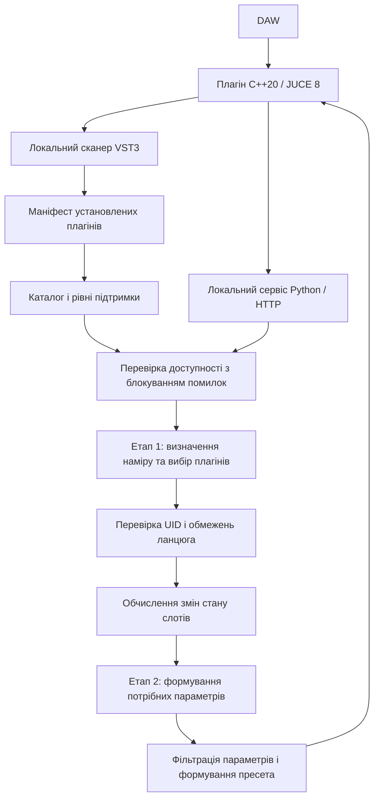

# ChainPrompt AI — shmlv. systems

**Дослідження та розробка (R&D) для B2B-аудіосистем: C++20 / JUCE 8 / VST3 DSP та детермінована перевірка плагінів із блокуванням непідтверджених змін.**

[](https://github.com/DenisShumilov/chainprompt-ai/actions/workflows/backend-tests.yml)
[](https://github.com/DenisShumilov/chainprompt-ai/actions/workflows/plugin-build.yml)

ChainPrompt AI — інженерний прототип керованого формування послідовних ланцюгів аудіоефектів у цифровій звуковій робочій станції (DAW). Система поєднує локальний вузол цифрової обробки сигналу (DSP), облік установлених VST3-плагінів і мовну модель для планування змін. Застосування пропозицій проходить через програмні перевірки доступності плагінів, ідентифікаторів, параметрів і стану ланцюга.

**Статус:** активна R&D-розробка з ручним розгортанням. Репозиторій призначений для технічної оцінки архітектури та інтеграційних сценаріїв. Промислова експлуатація потребує завершення перевірок реального часу, сумісності з DAW, пакування та керування життєвим циклом серверної частини.

## Призначення для B2B-інтеграцій

Проєкт досліджує контрольоване використання ШІ в аудіопродуктах, де рішення залежать від фактично встановлених інструментів і поточного стану сесії. Основний сценарій — побудова або коригування послідовного ланцюга ефектів на одному треку за текстовим запитом та аудіоконтекстом.

Для технічних команд виробників аудіоплагінів, DAW та студійних систем репозиторій надає основу для оцінки:

- інтеграції C++20 / JUCE 8 з локальним сервісом оркестрації ШІ;
- обліку VST3-плагінів через маніфест як авторитетне джерело доступності;
- детермінованих правил допуску пропозицій моделі до зміни ланцюга;
- обчислення різниці між поточним і бажаним станами зі збереженням ідентичності слотів;
- діагностики, регресійних перевірок та розширення підтримки метаданих різних виробників.

## Архітектура

Система складається з двох процесів. Плагін JUCE відповідає за аудіограф, сканування, стан слотів та взаємодію з DAW. Локальний Python-сервіс відповідає за каталог, запити до Gemini, планування змін і валідацію результатів.



Локальна архітектура зберігає стан DAW та облік установлених плагінів на машині користувача. Запити до Gemini виконуються через зовнішній API; склад переданих даних описано нижче.

## Детермінована перевірка плагінів із блокуванням помилок

Детермінованість стосується програмних правил перевірки за однакових вхідних даних і стану каталогу. Генерація відповідей мовною моделлю залишається ймовірнісною. Валідація доступності та параметрів не замінює перевірку стабільності сторонніх плагінів у конкретній DAW.

1. **Фіксація локального інвентарю.** Сканер формує `installed_plugins.json` із UID, виробником, форматом, версією та характеристиками каналів. Маніфест є основою каталогу; додаткові бази збагачують його метаданими.
2. **Раннє блокування за відсутності підтвердження.** Якщо маніфест відсутній або не завантажується, конвеєр зупиняється до виклику мовної моделі та повертає повідомлення про необхідність сканування.
3. **Відбір допустимих ефектів.** Каталог враховує ознаки інструментів і кількість вихідних каналів, щоб виключати непридатні для поточного сценарію інструменти та багатоканальні конфігурації.
4. **Перевірка ідентифікаторів.** Запропоновані UID звіряються з установленими плагінами. Наявність недоступних UID блокує формування ланцюга.
5. **Обмеження структури.** Програмні правила узгоджують формат, прибирають сусідні дублікати та обмежують ланцюг 16 плагінами.
6. **Обчислення змін.** Модуль порівняння визначає вставлення, збереження, видалення, перестановку та зміну стану обходу ефекту. Слоти мають стійкі ідентифікатори `slot_id`; логіка враховує ручні зміни та походження слотів.
7. **Кероване налаштування.** Другий етап генерує параметри лише для слотів, що потребують налаштування. Фільтри перевіряють параметри та переводять значення у формат VST.
8. **Повернення результату.** Плагін отримує структурований пресет для застосування. Стан інвентарю, треків і слотів доступний через локальні діагностичні маршрути.

Збереження ручних змін, стану обходу та автоматизації реалізовано на рівні логіки прототипу; наскрізні гарантії потребують розширеної перевірки в цільових DAW.

## Технологічна основа

| Підсистема | Реалізація |
| --- | --- |
| Аудіоядро та DSP | C++20, JUCE 8.0.12, `AudioProcessorGraph`, модуль `juce_dsp` |
| Формати збирання | VST3, AU та окремий застосунок; основний шлях перевірки — Windows / VST3 |
| Керування графом | Послідовний стереоланцюг, стан слотів, маршрутизація автоматизації, серіалізація стану |
| Серверна частина | Python, Flask, Waitress; прослуховування `127.0.0.1:5000` |
| Мовна модель | Google Gemini через `google-genai` |
| Дані | JSON-маніфести та метадані, SQLite для контексту студійної роботи |
| Метадані параметрів | Покриття Waves VST3, карти на 1001 точку, розширюваний контракт постачальників метаданих |
| Збирання та перевірки | CMake, Git LFS, pytest, робочі процеси GitHub Actions |

## Рівні підтримки плагінів

| Рівень | Умова | Поведінка |
| --- | --- | --- |
| Налаштовуваний (`configurable`) | Плагін установлено, карти параметрів доступні | Генерація параметрів із використанням метаданих |
| Доступний для завантаження (`hostable`) | Плагін установлено, карти параметрів відсутні | Завантаження із заводськими параметрами |
| Недоступний (`unavailable`) | UID відсутній у маніфесті | Відхилення під час перевірки доступності |

Найповніше покриття метаданих наразі має Waves VST3. Інші виробники можуть бути представлені в інвентарі та завантажуватися без генерації параметрів. Рівень у каталозі не є підтвердженням сумісності з усіма DAW.

## Локальне розгортання

### Передумови

- Windows 10/11 для поточного основного сценарію сканування та VST3; конфігурація AU для macOS потребує окремої перевірки.
- Python 3.11 — версія, що використовується в CI.
- Git і Git LFS для завантаження каталогів.
- CMake 3.24 або новіший та компілятор C++20; для Windows — Visual Studio 2022.
- Ключ Google Gemini API.
- Установлені VST3-плагіни; для поточного повного налаштування через ШІ — відповідні плагіни Waves.

### Отримання репозиторію

```bash
git lfs install
git clone https://github.com/DenisShumilov/chainprompt-ai.git
cd chainprompt-ai
git lfs pull
```

### Налаштування середовища

Створіть `.env` із шаблону. У PowerShell:

```powershell
Copy-Item .env.example .env
```

У середовищі з оболонкою Bash:

```bash
cp .env.example .env
```

Укажіть власний ключ у `.env`:

```dotenv
GEMINI_API_KEYS=ваш_ключ_Gemini_API
```

Файл `.env` має залишатися локальним і не потрапляти до комітів.

### Запуск серверної частини

```bash
python -m pip install -r requirements.txt
python server.py
```

В окремому терміналі перевірте стан сервісу:

```bash
curl http://127.0.0.1:5000/health
```

Значення `inventory.available: false` означає, що потрібно завантажити плагін і виконати сканування. Команда повторного сканування в інтерфейсі має назву `Rescan`; після сканування сервер оновлює маніфест і метадані через `/api/rescan`.

### Збирання плагіна

```bash
cmake -S plugin -B plugin/build
cmake --build plugin/build --config Release
```

Під час першої конфігурації CMake завантажує JUCE 8.0.12 через `FetchContent`, тому потрібне мережеве з'єднання. Шлях до `data/` визначається під час конфігурації; після переміщення репозиторію слід повторити конфігурацію та збирання.

Завантажте отриманий VST3 у DAW або запустіть окремий застосунок для перевірки локального інвентарю. Серверна частина має працювати окремим процесом.

### Регресійні перевірки

```bash
python -m pytest server/tests
```

Набір перевіряє логіку порівняння ланцюгів, блокування конвеєра без інвентарю, валідацію UID та фільтри параметрів. Перевірки Python не замінюють аудіотестування, перевірку потоків виконання та випробування в DAW.

## Діагностичні маршрути

| Маршрут | Метод | Призначення |
| --- | --- | --- |
| `/health` | GET | Стан сервісу, моделі, інвентарю та каталогу |
| `/api/chat` | POST | Обробка запиту та формування пропозиції зміни ланцюга |
| `/api/rescan` | POST | Оновлення маніфесту й метаданих без перезапуску сервісу |
| `/api/diag` | GET | Діагностика треків і слотів |
| `/api/ping` | POST | Фонова передача стану з плагіна |
| `/api/tracks` | GET | Перегляд збереженого стану треків |

## Стан валідації та інженерні обмеження

У [плані валідації](docs/VALIDATION_PLAN.md) зафіксовано результати попередніх перевірок Windows VST3: pluginval із рівнем суворості 5 завершувався успішно. На рівні 10 тестові секції проходили, проте за ввімкнених перевірок графічного інтерфейсу процес завершувався з ненульовим кодом. Проблема завершення роботи редактора залишається відкритою.

До промислового впровадження необхідно врахувати такі обмеження:

- Аудіограф підтримує стерео; монофонічні конфігурації не пройшли повну перевірку. Посили, повернення та бічні керувальні входи не входять до поточного сценарію.
- Сумарна затримка вкладених плагінів не передається DAW; компенсацію затримки ланцюга не реалізовано.
- Застосування пресетів може викликати сповіщення параметрів вкладених плагінів з аудіопотоку. Зміни графа, обхід ефектів і сканування в процесі хоста потребують цільового аудиту безпеки реального часу.
- Відновлення сесії з відсутнім плагіном може відхилити весь ланцюг; повторне збереження в такому стані записує порожній ланцюг.
- Матриця сумісності з DAW, версіями ОС і виробниками плагінів неповна. AU потребує перевірки на macOS.
- Залишаються платформні припущення у шляхах сканування та вилученні метаданих, а також залежності від поточного покриття Waves.
- Розгортання й запуск сервера виконуються вручну. Інтерфейс попереднього перегляду, погодження та відкату змін потребує доопрацювання.

## Дані та безпека інтеграції

Сервіс прив'язаний до `127.0.0.1`; локальні маршрути не мають автентифікації. Поточна конфігурація призначена для роботи на машині розробника. Мережеве розгортання потребує окремої моделі доступу й захисту транспорту.

Залежно від сценарію до Gemini можуть передаватися текст запиту, контекст ланцюга, метадані плагінів, аудіометрики та аудіодані. Налагоджувальне журналювання вмикається через `CHAINPROMPT_DEBUG=1` і може містити фрагменти запитів, відповідей та назви треків. Докладні правила наведено в [описі безпеки та приватності](SECURITY.md).

## Пріоритети R&D

1. Усунути проблему завершення роботи редактора в pluginval і перевірити зміни графа та параметрів щодо вимог реального часу.
2. Реалізувати облік затримки вкладених плагінів і перевірити збереження, відновлення та автоматизацію в цільових DAW.
3. Забезпечити відтворюване розгортання на чистому середовищі та керований запуск серверної частини.
4. Розширити покриття метаданих виробників і зробити рівні підтримки видимими в інтерфейсі.
5. Завершити попередній перегляд, погодження й відкат змін та сформувати критерії приймання для B2B-інтеграцій.

## Технічні матеріали

- [Архітектура системи та контракти даних](docs/ARCHITECTURE.md)
- [Архітектура плагіна](plugin/docs/ARCHITECTURE.md)
- [План валідації та матриця сумісності](docs/VALIDATION_PLAN.md)
- [Інженерний розбір проєкту](docs/CASE_STUDY.md)
- [План виконання](docs/EXECUTION_ROADMAP.md)
- [Реєстр ризиків](docs/RISK_REGISTER.md)
- [Безпека та приватність](SECURITY.md)

## Контакт і права

**shmlv. systems — Денис Шумілов**

Запити щодо технічної оцінки та B2B R&D-співпраці: [shmlvofficial@gmail.com](mailto:shmlvofficial@gmail.com).

Усі права захищено. Умови перегляду та використання матеріалів визначено у [LICENSE](LICENSE). Поширення, повторне використання й модифікація потребують попереднього письмового дозволу правовласника.
