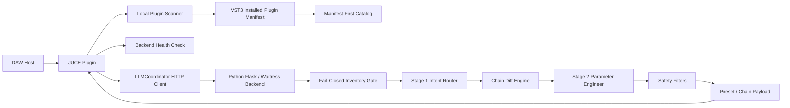

# ChainPrompt AI

Portfolio prototype: a JUCE plugin plus local Python backend for AI-assisted DAW insert-chain building.

It scans installed VST3 plugins, routes requests through Gemini, proposes bounded chain changes, and attempts to preserve tracked user edits such as bypassed or manually touched slots.

**Status:** working developer prototype, not production-ready. Manual backend startup, limited metadata coverage, packaging, and trust UX are still in progress.

**Demo path:** scan inventory -> build vocal chain -> inspect chain payload -> revise while preserving a manual change.

## Review Materials

Recommended reviewer path: README -> Case Study -> Demo Plan -> Validation Plan -> Security Notes.

- [Case Study](docs/CASE_STUDY.md)
- [Demo Plan](docs/DEMO_PLAN.md)
- [Validation Plan](docs/VALIDATION_PLAN.md)
- [Security and Privacy Notes](SECURITY.md)

## What This Demonstrates

- Refuses to build when installed plugin inventory is unavailable.
- Validates build payloads against a local installed-plugin manifest instead of trusting hallucinated tools.
- Computes chain diffs instead of blindly replacing the current chain.
- Attempts to preserve user-touched, user-owned, and bypassed slot state.
- Exposes backend, inventory, and track diagnostics through local endpoints.

## Product Philosophy: Scaffold Over Magic

The LLM is not the product. The product is the rule-bound workflow around it: inventory authority, fail-closed gates, UID validation, chain diffing, user-state preservation, diagnostics, and review boundaries.

ChainPrompt AI treats the model as one component inside a larger safety scaffold. That scaffold is what makes AI useful in a DAW context, where host state, installed tools, recovery paths, and user intent matter as much as the generated answer.

## Problem

Music producers often know the result they want, but building a useful insert chain still requires plugin knowledge, routing decisions, gain staging awareness, and many small repetitive choices.

Generic AI chat tools can suggest "a vocal chain" or "a mastering chain", but they usually do not know:

- which plugins are actually installed on the user's machine
- whether a plugin can be safely instantiated by the host
- what the current chain already contains
- which settings or bypass states were manually chosen by the user
- when the system should refuse to act instead of hallucinating tools

In a DAW, this matters. Bad automation is not just a wrong answer. It can interrupt a session, overwrite work, or create a chain the user cannot reproduce.

## Solution

ChainPrompt AI explores a narrower and safer direction: AI assistance for **serial insert-chain mutation** on the current track.

The prototype connects a JUCE audio plugin to a local Python backend. The plugin scans the local VST3 inventory, exports an installed plugin manifest, reports health and track state, and sends bounded requests to the backend. The backend uses Gemini to route intent, validate plugin choices, compute a chain diff, generate parameter suggestions for only the plugins that need them, and return a preset payload to the plugin.

The core idea is simple: the AI may assist, but the host, inventory, audio context, and user-owned state remain the source of truth.

## Why Now

Recent DAW releases are beginning to add assistant-style features. Fender Studio Pro 8.1, announced on June 9, 2026, is one reference point, with an in-DAW Studio Assistant for real-time answers and technical direction.

ChainPrompt AI is not trying to copy a full DAW assistant. It focuses on one adjacent execution problem: how an AI system can propose bounded insert-chain changes using real host state.

Reference: [Fender Studio Pro 8.1 announcement](https://www.prnewswire.com/news-releases/introducing-fender-studio-pro-8-1-keeping-artists-at-the-core-of-the-creative-process-302794510.html)

## Key Features / Technical Proof Points

- **JUCE plugin:** C++20 audio plugin with VST3, AU, and Standalone targets configured. The current inventory/hosting path is VST3-first, and broad host compatibility testing is still pending.
- **Local backend:** Python Flask/Waitress service with Gemini orchestration, retry, and fallback support.
- **Manifest-first inventory:** local VST3 scan exports an installed-plugin manifest; the backend filters for chain-eligible effects where metadata exists.
- **Bounded chain planning:** Stage 1 intent routing, UID validation, chain diffing, targeted Stage 2 parameter generation, and safety filters.
- **Diagnostics and tests:** `/health`, `/api/chat`, `/api/rescan`, `/api/diag`, `/api/ping`, plus backend regression tests for chain diff, inventory gating, and safety filters.

## Architecture Overview



The system is intentionally local-first. The DAW/plugin side owns host state and installed inventory. The backend owns orchestration, AI calls, catalog loading, diagnostics, and chain planning.

## Tech Stack

- **Audio/plugin:** JUCE 8, C++20, AudioProcessorGraph
- **Plugin formats:** VST3, AU, and Standalone targets configured; current validation is VST3-first
- **Backend:** Python, Flask, Waitress, Flask-CORS
- **AI:** Google Gemini via `google-genai`
- **State:** JSON manifests, SQLite studio memory
- **Build:** CMake
- **Tests:** pytest for backend logic

## How It Works

1. The user loads ChainPrompt AI in a DAW.
2. The plugin scans installed VST3 plugins and writes an installed plugin manifest.
3. The backend hot-reloads that manifest through `/api/rescan`.
4. The user asks for a chain, for example: "Build a clean modern vocal chain."
5. The backend checks that plugin inventory is available before spending LLM tokens.
6. Stage 1 routes the request as chat or build and selects real installed plugins.
7. The diff engine compares the current chain with the desired chain.
8. Stage 2 generates parameter suggestions only where needed.
9. Safety logic trims excessive chains, validates UIDs, and attempts to preserve user-owned state.
10. The plugin receives a bounded preset payload and updates the insert chain.

## Safety Principles

- **Host truth first:** real installed plugins and current chain state are authoritative.
- **Fail closed:** if inventory is unavailable, the system refuses to build.
- **Scaffold the model:** schemas, validators, diagnostics, and state checks matter as much as the model call.
- **No fake universality:** unsupported or missing plugins should be visible, not hidden.
- **Bounded mutation:** the prototype focuses on serial insert chains, not full-session autonomy.
- **Preserve user intent:** manual changes, user-added slots, and bypass states should survive AI actions; this is a prototype behavior that still needs broader host validation.
- **Explain degraded states:** backend and inventory problems are reported through health diagnostics.
- **Avoid silent overwrite:** AI-generated changes should not pretend to be user decisions.

## Current Status

This is a developer-operated prototype with working backend orchestration, inventory gating, chain diff logic, diagnostics, and regression tests.

What works now:

- Local backend startup and health endpoint
- Manual plugin scan and manifest reload flow
- Chat/build request pipeline
- Installed inventory gate
- Chain diff and merge model
- User-touched and bypass preservation logic
- Backend diagnostics for unreachable backend and unavailable inventory
- Backend regression tests for critical orchestration paths

Still in progress:

- Removing remaining machine-specific path assumptions
- Making setup easier for someone who is not the original developer
- Release packaging
- Trust-critical UI around preview, approve, rollback, and confidence
- Broader non-Waves metadata coverage
- Product-level QA across DAWs, OS versions, and plugin vendors

## Demo Scenario

Suggested demo flow:

1. Start the Python backend and show `/health`.
2. Load ChainPrompt AI as a plugin or standalone build.
3. Trigger a plugin rescan and show the backend inventory changing from unavailable to ready.
4. Ask: "Build a clean vocal chain using what is installed on this machine."
5. Show the AI response and the resulting chain payload.
6. Manually tweak or bypass one slot.
7. Ask for a revision and show that user-owned state is preserved or explicitly reported.
8. Open `/api/diag` to show track and slot diagnostics.

## Setup Instructions

### 1. Clone the repository

```bash
git clone https://github.com/DenisShumilov/chainprompt-ai.git
cd chainprompt-ai
```

### 2. Configure environment

```bash
cp .env.example .env
```

Edit `.env` and add your Gemini key:

```bash
GEMINI_API_KEYS=your_gemini_api_key_here
```

Do not commit `.env`.

### 3. Install Python dependencies

```bash
pip install -r requirements.txt
```

### 4. Start the backend

```bash
python server.py
```

The backend runs on:

```text
http://127.0.0.1:5000
```

### 5. Verify backend health

```bash
curl http://127.0.0.1:5000/health
```

If `inventory.available` is false, load the plugin and run a scan/rescan.

### 6. Build the plugin

```bash
cmake -S plugin -B plugin/build
cmake --build plugin/build --config Release
```

Load the generated VST3, AU, or Standalone build depending on your platform and host. VST3 is the current primary path; AU and Standalone targets are configured but not feature-validated across hosts yet.

### 7. Run backend tests

```bash
python -m pytest server/tests
```

## Useful Endpoints

| Endpoint | Method | Purpose |
| --- | --- | --- |
| `/health` | GET | Backend health, model, inventory, and catalog state |
| `/api/chat` | POST | Main chat/build pipeline |
| `/api/rescan` | POST | Hot-reload manifest and metadata after plugin scan |
| `/api/diag` | GET | Per-track diagnostics and slot-state visibility |
| `/api/ping` | POST | Background telemetry from the plugin |
| `/api/tracks` | GET | Stored track-state view |

## Roadmap

Near-term:

- Remove remaining legacy path assumptions in C++ runtime and scanner
- Add reproducible startup and rescan regression checks
- Make another developer able to boot the system from documentation alone
- Improve demo reliability and record a short walkthrough

Next:

- Add trust UX for preview, approve, rollback, and confidence
- Make supported vs. unsupported plugin behavior visible
- Improve metadata extraction beyond the current Waves-heavy path
- Package backend startup more cleanly

Later:

- Build one polished single-track vertical slice
- Add evaluation cases for vocal, guitar, drum, and mastering chains
- Explore multi-vendor support tiers
- Investigate deeper host integration only after the one-track workflow is reliable

## Limitations

- Prototype is developer-operated and not packaged as a consumer installer.
- The backend must be started manually.
- Current workflow is focused on serial insert chains on the current track.
- Sends, returns, sidechain routing, and session-wide autonomy are out of scope.
- Plugin support is not universal.
- Metadata support is strongest where local metadata exists.
- AU and Standalone targets are configured but not yet feature-validated across a host matrix.
- Real-time audio-thread safety, graph mutation, host notification behavior, in-process plugin scanning, pluginval checks, and host profiling still need a focused audit.
- Current scanner and metadata extraction paths still include Waves-specific and Windows-specific assumptions.
- Trust UX is not yet product-ready.
- Commercial release readiness would require much deeper QA, signing, packaging, privacy review, and host compatibility testing.

## What I Learned

- Audio AI features need host truth, not only good prompts.
- Plugin inventory must be treated as a safety boundary.
- A useful DAW copilot should degrade honestly when local state is missing.
- The hardest part is not generating a chain idea. It is preserving user work while applying bounded changes.
- Product strategy matters as much as model output when the tool lives inside a creative session.

## Why This Project Matters

ChainPrompt AI is a proof of direction for safety-oriented AI assistance inside music production tools.

It shows how a developer coming from web and full-stack systems can build toward audio software by combining:

- C++ plugin development
- local backend orchestration
- AI tool integration
- product safety thinking
- DAW workflow empathy

The project is intentionally narrow, but that is the point: one trustworthy workflow is more valuable than a broad AI demo that cannot respect the session.

## Contact

Denis Shumilov

For private review, share the cleaned repository link, demo video, and portfolio case study directly.
